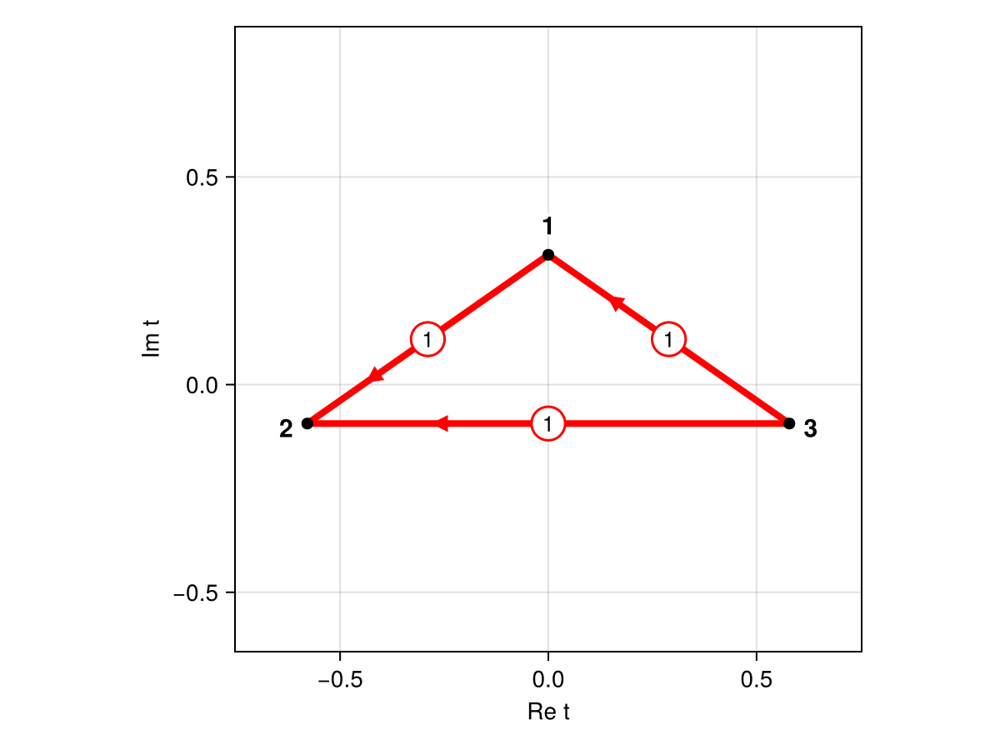

# Resurgence
[](https://jfeldbrugge.github.io/Resurgence.jl/stable/)
[](https://jfeldbrugge.github.io/Resurgence.jl/dev/)
[](https://github.com/jfeldbrugge/Resurgence.jl/actions/workflows/CI.yml?query=branch%3Amain)
[](https://codecov.io/gh/jfeldbrugge/Resurgence.jl)

<figure>
<a href='docs/src/assets/figures/stokes_graph.png'></a>
</figure>

Multidimensional oscillatory integrals

$$\Psi(k) = \left(\frac{k}{2\pi i}\right)^{d/2} \int_{\mathbb{R}^d} e^{i k f(\boldsymbol{x})}\, \mathrm{d}\boldsymbol{x}$$

with a polynomial (or, by a polynomial lift, rational) exponent $f$ are evaluated asymptotically with resurgence, implemented in Julia. Using integration by parts and Brieskorn reduction, the package constructs the Gauss–Manin system of the exponent, which generates the asymptotic series of all saddle points. Its Borel transform is a Fuchsian system, whose monodromy yields the Stokes constants and hence the adjacency of the saddle points. Combined with the South-East rule, this identifies the relevant saddle points and enables superasymptotic and hyperasymptotic approximations of the integral, without computing steepest-descent manifolds. This code accompanies the publication [Asymptotic evaluation of multidimensional oscillatory integrals](https://arxiv.org/abs/2610.22767).

## Installation

The Resurgence package is not yet registered in the General registry, but can be installed directly from GitHub with the Julia package manager.
From the Julia REPL, type `]` to enter the Pkg REPL mode and run:

```julia
pkg> add https://github.com/jfeldbrugge/Resurgence.jl
```

Or, equivalently, via the `Pkg` API:

```julia
julia> using Pkg; Pkg.add(url = "https://github.com/jfeldbrugge/Resurgence.jl")
```

## Usage
For the Pearcey integral with exponent $f(q) = q^4 + q^2/2 + q$, we compute the asymptotic series and the Stokes constants of the saddle points, determine the relevant saddle points with the South-East rule and approximate the integral $\Psi(k)$ at $k = 6$ (exact value $-0.1148611 - 0.4893380i$) as follows:

```julia
using Resurgence, DynamicPolynomials

@polyvar q
f = q^4 + 1//2 * q^2 + q

# Gauss-Manin system and the asymptotic series of all saddle points to order 60
GM     = GaussManin(f)
series = saddle_series(f, GM, 60)
Σ  = ComplexF64[s.t  for s in series]          # Borel singularities t = -iλ
T0 = ComplexF64[s.T0 for s in series]          # normalisation of the series
Rs = [ComplexF64.(R) for R in GM.Rs]           # residues of the Fuchsian system

# Adjacency: Stokes constants K[l, j] = K_{l←j}
K = stokes_constants(Σ, Rs, 0; T0 = T0, method = :matrix)
fig, ax = plotStokesGraphGM(Σ, K)

# Relevance: intersection numbers from the South-East rule
n = relevance(f, Σ, K, T0).n

# Superasymptotic and hyperasymptotic approximations of Ψ(k)
k = 6.0
superasymptotic(series, n, Σ, K, k).value                 # -0.11331 - 0.48913im
hyperasymptotic(series, n, Σ, K, k; level = 1).value      # -0.114860 - 0.489336im
```

Please have a look at the docstrings (e.g. `?stokes_constants`) for more details. The documentation is under development.

## Contributors
This code was written by:
* Job Feldbrugge ([jobfeldbrugge@ntu.edu.tw](mailto:jobfeldbrugge@ntu.edu.tw))

## Citations
When using this code in work, please cite

```
@article{CrewFeldbrugge2026,
    author = {Crew, Samuel and Feldbrugge, Job},
    title = {Asymptotic evaluation of multidimensional oscillatory integrals},
    year = {2026},
    eprint = {2610.22767},
    archivePrefix = {arXiv},
    url = {https://arxiv.org/abs/2610.22767},
}
```
